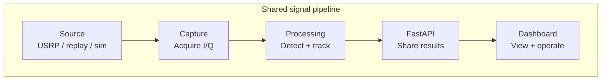
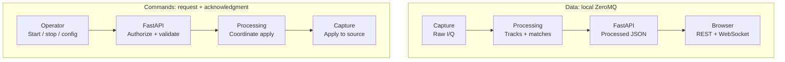
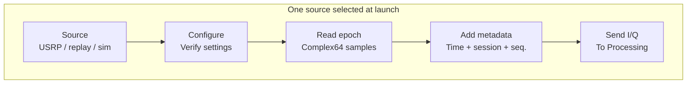
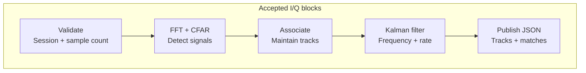
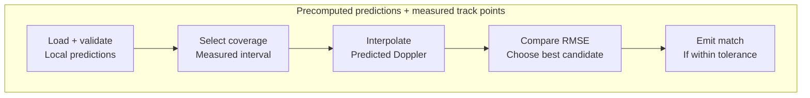
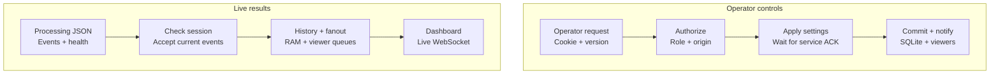
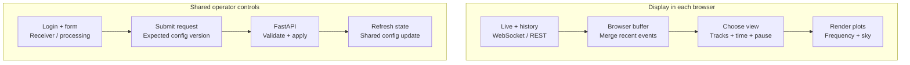
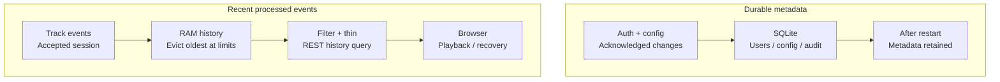
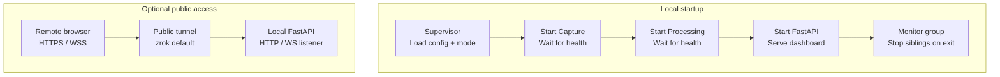

# Current system architecture

This document describes the implementation in this workspace, inspected on October 7, 2026. It shows supported source modes and optional public access, rather than asserting which services are running now.

Diagrams use short labels and at most five steps per row. Download the PNG beneath each diagram to insert it into a slide, or use SVG for scalable artwork. Detailed behavior is described in the text.

## Broad overview

One workstation owns the receiver, signal processing, web backend and storage. Capture converts the selected source into sample blocks. Processing detects signals, maintains tracks and compares them with precomputed satellite predictions. FastAPI manages shared configuration and distributes processed results to React dashboards. All viewers observe the same acquisition; each browser controls its own display and playback.

| Block | Responsibility | Main implementation |
| --- | --- | --- |
| Capture | Read one source, validate receiver settings and send timestamped I/Q | `capture/service.py` |
| Processing | FFT/CFAR detection, association, Kalman tracking and event generation | `processing/service.py`, `processing/tracker_adapter.py`, `satellite_tracker_api.py` |
| Prediction matching | Load trajectories, interpolate Doppler and compare measured tracks | `processing/prediction_store.py`, `processing/satellite_matcher.py` |
| FastAPI | Authenticate operators, coordinate shared changes and fan out live results | `backend/app/main.py` |
| React dashboard | Render live plots, recover history and submit operator commands | `frontend/src/main.tsx` |
| Storage | Persist metadata in SQLite and retain bounded processed history in RAM | `backend/app/db.py`, `backend/app/history.py` |
| Supervisor and access | Start/stop the process group and optionally expose public HTTPS | `scripts/run_local.py`, `scripts/run_public.py` |

Prediction matching runs inside Processing. Storage and history are managed inside FastAPI. The dashboard runs in each browser; these blocks do not each represent a separate server process.

**Slide image:** [PNG](docs/architecture-slides/diagrams/01-overview.png) · [SVG](docs/architecture-slides/diagrams/01-overview.svg)

## System connections

Data flows toward the browser; operator commands flow back toward Capture. Replies acknowledge commands. The pipeline and command channels use local ZeroMQ; the browser uses REST and WebSocket.

All internal ZeroMQ endpoints are restricted to IPv4 localhost: Capture commands on 5581, I/Q on 5582, Processing commands on 5583 and processed events on 5584. Each command channel includes an acknowledgment.

**Slide image:** [PNG](docs/architecture-slides/diagrams/02-connections.png) · [SVG](docs/architecture-slides/diagrams/02-connections.svg)

## Capture block

Capture reads one source mode selected at launch. `APPLY` configures the source while stopped; `START` enables acquisition. USRP settings are checked against hardware readback before Capture acknowledges them. Simulator and replay blocks follow the configured epoch pacing; USRP reads continuously.

Acquisition faults stop the source and remain visible through health responses. Raw I/Q is transmitted internally; live capture does not save recordings to disk.

**Slide image:** [PNG](docs/architecture-slides/diagrams/03-capture.png) · [SVG](docs/architecture-slides/diagrams/03-capture.svg)

## Processing block

Processing adapts the supplied `TrackingEngine` to continuous service operation. Each accepted block produces current estimates rather than accumulated track histories. The same detector and tracker process hardware, replay and simulator I/Q.

The Processing command handler also owns configuration transitions: `APPLY` validates settings, stops Capture, applies source settings, creates a fresh tracker and reloads predictions. `START` and `STOP` forward to Capture. A processing fault stops acquisition and requires applying/resetting configuration before restarting.

**Slide image:** [PNG](docs/architecture-slides/diagrams/04-processing.png) · [SVG](docs/architecture-slides/diagrams/04-processing.svg)

## Prediction matching block

Local JSON supplies satellite identity, timestamps, predicted Doppler, azimuth and elevation. The store validates finite, aligned arrays and increasing timestamps. Invalid records are reported in health; matching can proceed with valid records. Orbit propagation happens outside this live pipeline.

The tolerance is the matcher's current default. A match event is emitted when a qualifying satellite identity changes; repeated matches to the same identity do not create duplicate events. The simulator generates samples and does not fabricate satellite identities.

**Slide image:** [PNG](docs/architecture-slides/diagrams/05-matching.png) · [SVG](docs/architecture-slides/diagrams/05-matching.svg)

## FastAPI block

These components are functions, tasks and shared state within one FastAPI process, rather than separate services. Most orchestration is in `backend/app/main.py`; validation, persistence and history are in `models.py`, `db.py` and `history.py` respectively.

### Interaction details

- **Login and authorization:** login verifies an Argon2 password hash and stores a hash of the newly issued session token in SQLite. The browser receives the token in an HttpOnly cookie. Operator routes resolve that cookie to an unexpired account, enforce the operator role and check the request origin. Public monitoring routes do not require login.
- **Operator commands:** start, stop, reset and configuration changes all use the same mutation handler. Its lock serializes changes; the expected configuration version prevents stale edits. Every successful mutation creates a new version and capture/processing session IDs and applies a complete configuration through Processing to Capture. Start additionally issues `START` after `APPLY`. Only after verifying the acknowledgment does the backend persist metadata and broadcast the change. On failure it attempts to restore the previous service configuration and returns HTTP 503.
- **Live event ingestion:** one background subscriber receives Processing events. Tracking, lifecycle and satellite-match events are accepted only for the active processing session, appended to RAM history and broadcast. Health events update shared status and are broadcast without being added to history. A heartbeat indicating that capture ended can also reconcile persisted acquisition state.
- **History and live delivery:** REST history queries read the shared RAM deque, filter by time/session/track/sequence and thin large responses. WebSockets first send current configuration and health, then drain a separate queue per viewer. Queue overflow requests a resync and closes that connection; the frontend reconnects and fetches recent history through REST.
- **Status and persistence:** `/api/status` combines service health with backend queue, history and latency statistics and the persisted active configuration. Missing heartbeats mark service health unavailable. SQLite retains metadata across restarts; RAM status, viewer queues and processed history are recreated at startup.

**Slide image:** [PNG](docs/architecture-slides/diagrams/06-fastapi.png) · [SVG](docs/architecture-slides/diagrams/06-fastapi.svg)

## React dashboard block

Each browser holds its own display preferences, live buffer and playback position. Pause and history playback affect that browser's view; receiver and processing commands change the shared workstation state.

The browser thins plotted series to roughly 1,500 points and reports approximate receive-to-render timing. It never receives raw samples. Guests and viewers can monitor; the backend enforces operator authorization for shared commands.

**Slide image:** [PNG](docs/architecture-slides/diagrams/07-dashboard.png) · [SVG](docs/architecture-slides/diagrams/07-dashboard.svg)

## Storage and history block

SQLite stores durable metadata. A separate RAM deque stores processed tracking, lifecycle and match events for recent playback. Health and latency status are held in memory but are not appended to that history.

The history time window uses event timestamps, including recorded timestamps during replay. Dense traffic can reduce the available duration because the event and size caps also apply. SigMF files are external replay inputs; neither SQLite nor RAM history stores raw I/Q.

**Slide image:** [PNG](docs/architecture-slides/diagrams/08-storage.png) · [SVG](docs/architecture-slides/diagrams/08-storage.svg)

## Supervisor and access block

The local supervisor starts three child processes and waits for Capture and Processing command endpoints to become ready. FastAPI serves the built dashboard and applies shared settings. Acquisition remains stopped until an operator starts it.

Public access forwards only web traffic. Internal ZeroMQ command and data sockets remain on localhost. The workstation and tunnel must remain running for remote access; a systemd example and a Caddy proxy example are provided but are not installed automatically.

**Slide image:** [PNG](docs/architecture-slides/diagrams/09-supervisor.png) · [SVG](docs/architecture-slides/diagrams/09-supervisor.svg)

## End-to-end operation

1. The supervisor starts the three processes. FastAPI applies the shared configuration through Processing to Capture. Acquisition starts stopped.
2. An authenticated operator starts acquisition from the dashboard. FastAPI validates the role and configuration version, then sends the command through Processing to Capture.
3. Capture reads the selected source and sends complex I/Q samples with timestamps and session metadata. Its I/Q queue is bounded at 16 blocks; new blocks are dropped when delivery cannot keep up, and Processing accounts for sequence gaps.
4. Processing runs the supplied `TrackingEngine` in `satellite_tracker_api.py` through `TrackerAdapter`. It produces detections, frequency and Doppler-rate estimates, and track lifecycle events. When suitable prediction files exist, the matcher compares tracks against interpolated precomputed trajectories and emits satellite matches.
5. FastAPI receives processed JSON, retains recent events in shared memory, and broadcasts live events to browsers. REST history requests support playback and reconnect recovery. The backend and browser never receive raw I/Q.
6. SQLite persists authentication, configuration, session metadata and audit records. Processed history lives in RAM and is lost on restart. SigMF recordings are external inputs; the live pipeline does not persist raw I/Q.

Configuration changes stop acquisition, apply acknowledged settings, create new capture/processing session IDs, advance the shared version and notify viewers. Acquisition must then be started again. WebSocket queues are bounded at 256 events per viewer; slow viewers receive a resync signal and recover recent history after reconnecting.

## Deployment and prediction boundaries

`scripts/run_public.py` optionally supervises the public tunnel and local supervisor together. Its default is zrok with the configured reserved URL `https://funlab.shares.zrok.io`. Local-only operation uses `scripts/run_local.py`; a Caddy reverse-proxy example is also supplied in `config/Caddyfile.example`.

Predictions are provided as local JSON files. Orbit propagation is not part of the live pipeline. Satellite matching requires valid predictions covering the measured timestamps; the simulator does not fabricate satellite identities.

## Implementation references

- [Capture service](capture/service.py), [Processing service](processing/service.py), [IPC channels](processing/ipc.py)
- [Tracker adapter](processing/tracker_adapter.py), [Tracking engine](satellite_tracker_api.py), [Satellite matcher](processing/satellite_matcher.py), [Prediction store](processing/prediction_store.py)
- [Web backend](backend/app/main.py), [Database](backend/app/db.py), [Rolling history](backend/app/history.py), [React dashboard](frontend/src/main.tsx)
- [Local supervisor](scripts/run_local.py), [Public launcher](scripts/run_public.py)
